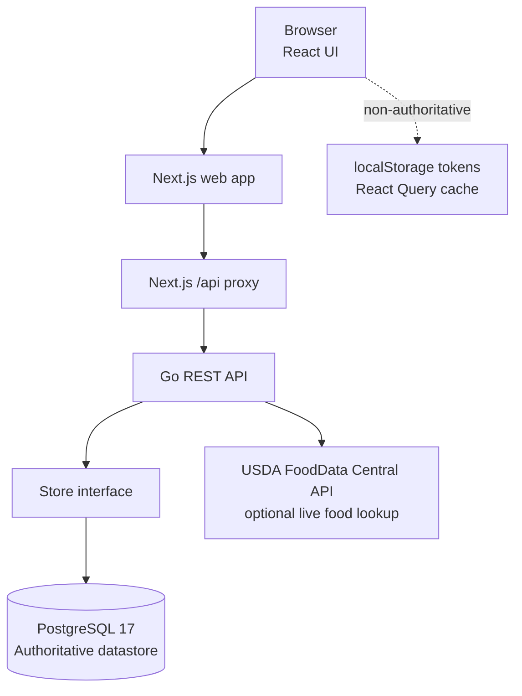
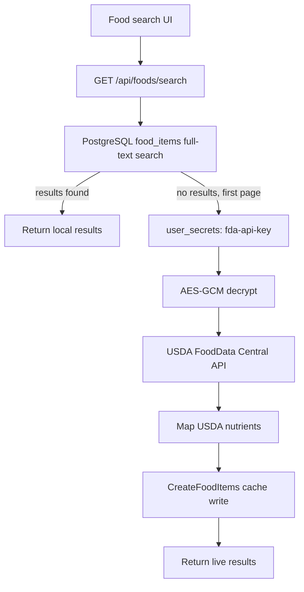
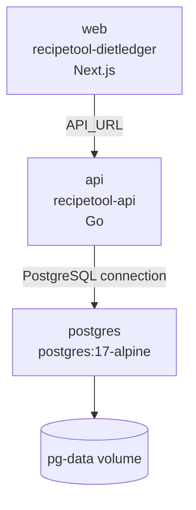

# DietLedger Data Storage Architecture

Status: Current runtime data-store reference  
Review basis: CodeGraph source review, `ARCHITECTURE.md`, `PROJECT.md`, `NUTRITION_DOMAIN.md`, `DECISIONS.md`, and current PostgreSQL migrations through `000024_recipe_completions`.

> DietLedger is now a server-authoritative, PostgreSQL-backed application.
>
> Older local-first/offline-first storage designs, IndexedDB authority, Prisma/SQLite application persistence, sync queues, conflict resolution, and SQLite production paths are historical only. Do not use them as the architecture for new work.

---

## 1. Storage architecture summary

DietLedger has one authoritative datastore:

```text
Browser
  -> Next.js web app and /api proxy
  -> Go REST API
  -> PostgreSQL
```

PostgreSQL is the system of record. The browser and frontend are not authoritative. The Go API owns validation, business rules, authorization, and persistence orchestration.



### Storage responsibilities

| Layer | Storage responsibility | Authoritative? |
|---|---|---|
| PostgreSQL | Durable application data, relationships, indexes, migration history | Yes |
| Go API | Enforces ownership, validation, and write paths into PostgreSQL | No persistent storage itself |
| Next.js | Presentation and same-origin API proxy | No |
| Browser | Access/refresh token storage, React Query cache, transient UI state | No |
| USDA API | External source for live food search fallback | External reference only |

---

## 2. Authoritative data-store rules

These rules come from `ARCHITECTURE.md`, `DECISIONS.md`, and `AGENTS.md`:

1. PostgreSQL is the only authoritative application datastore.
2. Persistent user/domain data must be represented in PostgreSQL and accessed through the Go API.
3. The Go API owns business rules, validation, authorization, and persistence orchestration.
4. Browser storage must not own cross-device state, secrets, or primary domain data.
5. React Query may cache server state but does not own it.
6. Zustand may own transient UI interaction state only.
7. New storage technologies, caches, queues, or persistence layers require a documented architectural decision.

---

## 3. Current runtime datastore

### PostgreSQL

| Property | Value |
|---|---|
| Runtime role | Sole authoritative datastore |
| Container image | `postgres:17-alpine` in `docker-compose.yml` |
| Docker volume | `pg-data:/var/lib/postgresql/data` |
| Go driver | `github.com/jackc/pgx/v5/stdlib` through `database/sql` |
| Store implementation | `sync-server/store_postgres.go` (`PostgresStore`) |
| Store contract | `sync-server/repository.go` (`Store`) |
| Migration runner | `sync-server/migrate.go` |
| Migrations | Embedded SQL files in `sync-server/migrations/*.sql` |
| Startup behavior | `sync-server/main.go` requires PostgreSQL connection and runs migrations before serving |

### PostgreSQL connection settings in code

`NewPostgresStore` configures the SQL pool as:

| Setting | Value |
|---|---|
| Max open connections | 25 |
| Max idle connections | 5 |
| Connection max lifetime | 5 minutes |

---

## 4. Removed or non-authoritative storage paths

The following are not current authoritative runtime storage paths:

| Historical / non-authoritative path | Current status |
|---|---|
| IndexedDB as domain storage | Removed as authoritative storage. Do not design new features around it. |
| Offline-first sync engine | Removed from current architecture. No conflict-resolution system is part of the runtime path. |
| Browser write queue / local-first ownership | Historical only. Writes go through the Go API. |
| Prisma/SQLite application persistence | Historical/local-mode documentation only; not the production/runtime authority. |
| SQLite production backend | Removed by ADR; PostgreSQL is the only production datastore. |
| Next.js API routes for domain behavior | Removed as application backend; Next.js now proxies `/api` to Go for domain routes. |

Current `src/app/api` utility routes, if present, must not become a parallel application backend for domain persistence.

---

## 5. Data ownership model

### Ownership by system

| System | Owns |
|---|---|
| PostgreSQL | Users, recipes, foods, logs, profiles, meal plans, books, settings, secrets, templates, sharing data, and all durable relationships |
| Go API | Validation, authorization, domain rules, persistence sequencing, migrations, USDA fallback/cache writes |
| React Query | Non-authoritative client-side cache of server data |
| Browser localStorage | Auth token/user convenience state only |
| Zustand/component state | Transient UI workflow state only |

### Ownership by data category

| Data category | Authoritative tables | Owner boundary |
|---|---|---|
| Identity and auth | `users`, `api_keys`, `refresh_tokens` | Per user; API keys user-scoped; current refresh flow is JWT-based |
| Instance administration | `instance_meta` | Single-row instance-level configuration |
| Recipes | `recipes`, `ingredients`, `recipe_categories`, `recipe_completions` | Per user for recipes and completions; categories shared |
| Food reference/cache | `food_items`, `seed_jobs` | Shared system food cache |
| Custom foods | `custom_foods` | Per user plus community-sharing flag |
| Nutrition tracking | `person_profiles`, `food_log_entries`, `weight_entries` | Per user/profile |
| Meal planning | `meal_plans`, `day_plan_entries`, `meal_groups`, `grocery_checklists` | Per user |
| Cookbook publishing | `recipe_books`, `chapters`, `chapter_recipes`, `chapter_pages`, `book_pages`, `templates`, `brand_kits` | Per user, with default templates possible |
| Dietary compliance | `dietary_profiles`, `allergen_rules` | Per user |
| Settings/location/pantry | `user_settings`, `user_locations`, `pantry_staples`, `seasonal_foods` | User-specific plus shared seasonal/global pantry data |
| Sharing/community | `shared_recipes`, `recipe_ratings`, `community_categories` | Mixed owner/public visibility model |
| Secrets | `user_secrets` | Per-user encrypted secrets |

---

## 6. Current schema inventory

The schema is defined by migrations in `sync-server/migrations`. The tables below are grouped by domain.

### Platform and identity

| Table | Purpose | Key ownership / notes |
|---|---|---|
| `users` | Accounts, password hashes, API key, admin flag | Primary identity table. `is_admin` added by migration `000014`; earliest existing user becomes admin. |
| `devices` | Device metadata | References `users`; retained by schema. |
| `api_keys` | User API keys | Stores `key_hash`, `key_prefix`, permissions; keys are accepted as bearer credentials by `requireAuth`. |
| `refresh_tokens` | Refresh-token table from early schema | Table exists, but current `AuthService.RefreshToken` validates signed refresh JWTs directly. |
| `instance_meta` | Single-row instance state | Tracks onboarding completion, registration toggle, onboarding version. |
| `schema_migrations` | Applied migration versions | Created and maintained by `RunMigrations`. |

### Recipes and ingredients

| Table | Purpose | Key ownership / notes |
|---|---|---|
| `recipes` | User-owned recipe records | Includes name, servings, serving name, instructions, leftover storage, ingredient groups, prep time, cook time. |
| `ingredients` | Ingredient snapshots attached to recipes | Carries canonical nutrients plus description, prep instructions, storage location, group ID, optional linked recipe ID. |
| `recipe_categories` | Recipe/category join table | Unique recipe/category association. |
| `recipe_completions` | Latest cooked/completed date per user and recipe | Primary key `(user_id, recipe_id)`; replaces old localStorage completion tracking. |

### Food data and custom foods

| Table | Purpose | Key ownership / notes |
|---|---|---|
| `food_items` | Shared USDA/imported/live-cached food data | Has `fdc_id`, description, brand, UPC, serving info, canonical nutrients, source, timestamps, `search_vector`. |
| `custom_foods` | User-created foods | User-owned; can be shared with community via `shared_with_community`. |
| `seed_jobs` | USDA dataset import job tracking | Tracks dataset type, release date, status, progress, errors, checkpoints. |

### Nutrition and health tracking

| Table | Purpose | Key ownership / notes |
|---|---|---|
| `person_profiles` | People/profiles tracked by a user | Demographics, activity level, goals, nutrient targets. |
| `food_log_entries` | Historical food consumption snapshots | Stores canonical nutrients as a snapshot; does not live-update when recipes change. |
| `weight_entries` | Weight and health measurements | Weight is nullable after migration `000018`; date uniqueness was removed by `000017`; `time` added by `000019`. |

### Meal planning and grocery

| Table | Purpose | Key ownership / notes |
|---|---|---|
| `meal_plans` | Weekly meal plans | Unique by `(user_id, week_start)` after migration `000009`. |
| `day_plan_entries` | Planned recipe/manual/custom-food entries | Stores slot/date/source/servings plus nutrient snapshot values. |
| `meal_groups` | Grouping within meal plan days/slots | Child of `meal_plans`. |
| `grocery_checklists` | User grocery checklist by week | Uses JSONB `checked_items` after migration `000010`; unique by user/week. |

### Cookbook organization and publishing

| Table | Purpose | Key ownership / notes |
|---|---|---|
| `categories` | Shared hierarchical category tree | Self-referencing parent/child categories; seeded by API startup. |
| `recipe_books` | User-owned cookbook/book records | Title, description, cover color. |
| `chapters` | Book chapters | Position plus optional template references. |
| `chapter_recipes` | Recipes included in chapters | Join table with position. |
| `chapter_pages` | Free-form chapter pages | Content and position inside a chapter. |
| `book_pages` | Free-form book-level pages | Content and position at book level. |
| `templates` | Render/export layout templates | User-owned or default templates; layout stored as JSONB. |
| `brand_kits` | Publishing brand settings | Logo data URL, colors, font family, tagline. |

### Dietary compliance, settings, and reference data

| Table | Purpose | Key ownership / notes |
|---|---|---|
| `dietary_profiles` | Dietary restriction/goal profiles | User-owned; allergens, tags, thresholds in JSONB. |
| `allergen_rules` | Rules attached to dietary profiles | User/profile-owned; severity and custom keywords. |
| `user_settings` | User settings JSON | One row per user. |
| `user_locations` | User location for seasonal data | One row per user; country and region. |
| `seasonal_foods` | Shared seasonal produce/reference foods | Unique by country, region, month; seeded by migration `000016`. |
| `pantry_staples` | Pantry staple names | Supports user-specific and global staples after migration `000022`. |
| `user_secrets` | Encrypted user secrets | Stores encrypted values such as per-user USDA/FDA API key. |

### Sharing and community

| Table | Purpose | Key ownership / notes |
|---|---|---|
| `shared_recipes` | Published recipe share records | Stores share token, recipe payload, visibility, ratings/views/imports. |
| `recipe_ratings` | User ratings for shared recipes | Unique by recipe/user. |
| `community_categories` | Community category list | Shared lookup table. |

---

## 7. Canonical nutrient model

DietLedger uses one canonical nutrient set across food items, ingredients, recipes, meal-plan snapshots, and food logs.

| Nutrient | API/client name | Storage naming pattern |
|---|---|---|
| Calories | `calories` | `calories` |
| Total fat | `totalFat` | `total_fat` |
| Saturated fat | `saturatedFat` | `saturated_fat` |
| Trans fat | `transFat` | `trans_fat` |
| Cholesterol | `cholesterol` | `cholesterol` |
| Sodium | `sodium` | `sodium` |
| Total carbohydrates | `totalCarbs` | `total_carbs` |
| Dietary fiber | `dietaryFiber` | `dietary_fiber` |
| Total sugars | `totalSugars` | `total_sugars` |
| Added sugars | `addedSugars` | `added_sugars` |
| Protein | `protein` | `protein` |
| Vitamin D | `vitaminD` | `vitamin_d` / `vitamin_d_goal_ug` |
| Calcium | `calcium` | `calcium` |
| Iron | `iron` | `iron` |
| Potassium | `potassium` | `potassium` |

Domain rules:

- Vitamin D is stored in micrograms after migration `000023`; USDA IU values are converted at 40 IU per microgram during ingestion.
- Food log entries and meal-plan entries are nutrient snapshots.
- Historical food logs must not silently change when a source food or recipe changes.
- Nutrition fields are validated server-side for non-negative, bounded values where handlers use the validation helpers.

---

## 8. Migration history

Migrations are embedded into the Go binary and applied by `RunMigrations` at startup.

| Migration | Purpose |
|---|---|
| `000001_init` | Users, devices, API keys, refresh tokens. |
| `000002_recipes` | Recipes and ingredients. |
| `000003_foods` | Food items, custom foods, seed jobs. |
| `000004_nutrition` | Person profiles, food log entries, weight entries. |
| `000005_meal_plans` | Meal plans, day plan entries, meal groups, grocery checklists. |
| `000006_books` | Categories, books, chapters, chapter recipes, chapter pages, book pages, recipe categories. |
| `000007_sharing` | Shared recipes, recipe ratings, community categories. |
| `000008_fts` | PostgreSQL full-text search support for `food_items`. |
| `000009_meal_plans_unique_fix` | Meal-plan uniqueness changed to `(user_id, week_start)`. |
| `000010_grocery_jsonb` | Grocery checklist checked items moved to JSONB. |
| `000011_ingredient_prep_storage` | Ingredient prep instructions and storage location. |
| `000012_ingredient_details_groups` | Ingredient description, group/link fields, recipe ingredient groups. |
| `000013_phase2_server_data` | Settings, templates, dietary profiles, allergen rules, brand kits, pantry staples, locations, seasonal foods, user secrets. |
| `000014_user_admin` | User admin flag and initial admin assignment. |
| `000015_share_visibility` | Three-tier share visibility (`private`, `users`, `public`) replaces `is_public`. |
| `000016_seasonal_foods_seed` | Seeds seasonal foods reference data. |
| `000017_weight_entries_drop_unique` | Allows multiple weight entries per profile/date. |
| `000018_weight_nullable` | Makes `weight_entries.weight_kg` nullable. |
| `000019_weight_time` | Adds time field to weight entries. |
| `000020_instance_meta` | Adds single-row instance metadata. |
| `000021_recipe_times` | Adds recipe prep and cook time fields. |
| `000022_global_pantry_staples` | Adds global pantry staples and partial unique indexes. |
| `000023_vitamin_d_iu_to_mcg` | Converts stored vitamin D values from IU to micrograms for food items and USDA-linked ingredients. |
| `000024_recipe_completions` | Adds server-side recipe completion tracking. |

Migration rules:

- New persistent schema changes must be made through `sync-server/migrations`.
- The Go `Store` interface and `PostgresStore` implementation must be updated with schema changes.
- API handlers and frontend typed clients must be kept in sync with schema/API contract changes.
- Existing data semantics, especially nutrition snapshots, must be preserved unless a spec explicitly changes them.

---

## 9. Food data architecture

### Local-first search with live fallback

Food search is server-authoritative and currently requires authentication in the Go routes.



### Food search details

| Concern | Current behavior |
|---|---|
| Local query | `PostgresStore.SearchFoods` queries `food_items.search_vector` with `plainto_tsquery`. |
| Index | `idx_food_items_search` GIN index. |
| Trigger | `trg_food_items_search_vector` updates the search vector on insert/update. |
| Live fallback | Only on local miss, non-empty query, page 1. |
| External key | Per-user secret named `fda-api-key`, encrypted in `user_secrets`. |
| Live timeout | USDA live search uses a 15-second HTTP timeout. |
| Cache write | Live USDA results are inserted into shared `food_items`; cache errors do not block returning live results. |
| Bulk import | Seed jobs download USDA datasets and batch insert food items. |

---

## 10. Security-sensitive data

### Passwords and API keys

| Data | Storage approach |
|---|---|
| User passwords | Bcrypt hashes in `users.password_hash`. |
| User API keys | Hashed in `api_keys.key_hash`; prefix stored for display/lookup. |
| Legacy user API key field | `users.api_key` exists from initial schema and is part of the user model. |
| Access/refresh tokens | Signed JWTs generated by `AuthService`; browser stores them in localStorage. |

### User secrets

`user_secrets` stores encrypted user-owned secrets.

| Field | Purpose |
|---|---|
| `user_id` | Owner. |
| `key_name` | Secret name, e.g. `fda-api-key`. |
| `encrypted_value` | AES-GCM encrypted value. |

Encryption uses `encryptSecret`/`decryptSecret` with a key derived from `AuthService.SecretKey()`. Production deployments must provide a stable `HMAC_SECRET`; otherwise the app generates a random secret at startup, making tokens invalid after restart and potentially preventing decryption of previously stored user secrets.

---

## 11. API route groups and table interactions

The Go API routes are registered in `sync-server/server.go`. The frontend `GoApiClient` calls same-origin `/api/*`; Next.js middleware proxies those requests to the Go API.

| Route group | Representative endpoints | Main tables |
|---|---|---|
| Auth | `/api/auth/register`, `/login`, `/refresh` | `users` |
| Instance/admin | `/api/instance/state`, `/registration`, `/users`, `/reset-user-data`, `/factory-reset` | `instance_meta`, `users`, many user-owned tables for reset/delete |
| Account | `/api/account/delete-data`, `/delete` | User-owned tables, `users` |
| Recipes | `/api/recipes`, `/api/recipes/{id}`, `/api/recipes/completions` | `recipes`, `ingredients`, `recipe_categories`, `recipe_completions` |
| Foods | `/api/foods/search`, `/api/foods/{fdcId}`, `/api/foods/upc/{upc}` | `food_items`, `seed_jobs`, `user_secrets` for live fallback |
| Nutrition profiles/logs/weight | `/api/profiles`, nested log/weight routes | `person_profiles`, `food_log_entries`, `weight_entries` |
| Meal plans/grocery | `/api/meal-plans`, entries/groups, `/api/grocery` | `meal_plans`, `day_plan_entries`, `meal_groups`, `grocery_checklists` |
| Books/pages/chapters | `/api/books`, `/api/chapters`, `/api/pages`, `/api/chapter-recipes` | `recipe_books`, `chapters`, `chapter_recipes`, `chapter_pages`, `book_pages` |
| Categories | `/api/categories` | `categories`, `recipe_categories` |
| Custom foods | `/api/custom-foods`, `/api/custom-foods/community` | `custom_foods` |
| Sharing/community | `/api/share`, `/api/share/{token}`, `/api/community` | `shared_recipes`, `recipe_ratings`, `community_categories` |
| Settings/templates/branding | `/api/settings`, `/api/templates`, `/api/brand-kits` | `user_settings`, `templates`, `brand_kits` |
| Dietary/allergens | `/api/dietary-profiles`, `/api/allergen-rules` | `dietary_profiles`, `allergen_rules` |
| Pantry/location/seasonal | `/api/pantry-staples`, `/api/settings/location`, `/api/settings/seasonal-foods` | `pantry_staples`, `user_locations`, `seasonal_foods` |
| Secrets | `/api/secrets` | `user_secrets` |

---

## 12. Client-side storage and caching

Client-side storage is allowed only for non-authoritative concerns.

| Mechanism | Current use | Rules |
|---|---|---|
| `localStorage` | Access token, refresh token, serialized current user | Convenience/session state only; not durable domain authority. |
| React Query cache | Server-state cache and mutation state | Must be invalidated/refetched after writes; not source of truth. |
| Component state | Form inputs and local UI interactions | Transient only. |
| Zustand | Dialogs, selections, drag/drop/editor UI state if used | Must not own server data. |

No client-side storage should contain long-lived secrets such as USDA API keys. User secrets belong in `user_secrets` through the Go API.

---

## 13. Deployment data architecture

`docker-compose.yml` defines the runtime data topology:



| Service | Data role |
|---|---|
| `postgres` | Owns durable database files under Docker volume `pg-data`. |
| `api` | Runs migrations and performs all database reads/writes. |
| `web` | Proxies browser `/api` requests to `api`; no domain database access. |

Important deployment rule from `AGENTS.md`: local builds do not update running services. Deployable artifacts are Docker images saved as a single combined tar and loaded on the remote host.

---

## 14. Backup, retention, and recovery notes

The current repository defines PostgreSQL persistence through the Docker volume `pg-data`, but does not define a complete backup/retention policy in code.

Recommended operational documentation to add separately:

- PostgreSQL logical backup command and schedule.
- Restore procedure tested against a non-production database.
- Docker volume backup expectations on the remote host.
- Secret management expectations for `HMAC_SECRET`, database password, and optional JWT signing key.
- USDA food cache rebuild strategy through seed jobs and live fallback.

---

## 15. Data-store change checklist

Before changing storage behavior:

1. Identify the owning domain and authoritative table.
2. Confirm the change belongs in PostgreSQL and the Go API.
3. Write or update the spec/acceptance criteria.
4. Add a migration for schema changes.
5. Update `Store` and `PostgresStore`.
6. Update handlers and server-side validation.
7. Update frontend typed client/hooks only after the API contract is defined.
8. Add focused tests before behavior changes.
9. Update `ARCHITECTURE.md`, `DECISIONS.md`, `NUTRITION_DOMAIN.md`, API docs, or this file as applicable.
10. Verify with focused tests or document why docs-only verification is sufficient.

---

## 16. Source file reference

| Area | Files |
|---|---|
| Architecture rules | `ARCHITECTURE.md`, `DECISIONS.md`, `AGENTS.md` |
| Product/domain requirements | `PROJECT.md`, `NUTRITION_DOMAIN.md` |
| Go API startup | `sync-server/main.go` |
| Routes/middleware | `sync-server/server.go` |
| Auth | `sync-server/auth.go` |
| Store contract | `sync-server/repository.go` |
| PostgreSQL store | `sync-server/store_postgres.go` |
| Migrations | `sync-server/migrations/*.sql`, `sync-server/migrate.go` |
| Food import/fallback | `sync-server/seed.go`, `sync-server/usda_live.go`, `sync-server/handlers_food.go` |
| Validation | `sync-server/validation.go`, `sync-server/validation_nutrition.go` |
| Frontend API client | `src/lib/api-client.ts`, `src/lib/api-client-go.ts` |
| API proxy | `src/proxy.ts`, `middleware.ts` |
| Deployment | `docker-compose.yml`, `docker-compose.build.yml`, operator-managed image loading |
