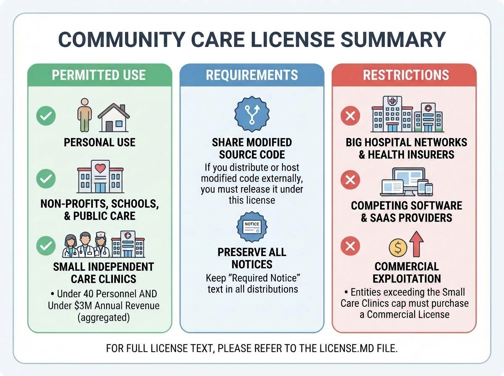

# DietLedger

DietLedger is a community-focused nutrition, diet-tracking, and care-management tool built to help individuals, schools, non-profits, and independent care providers support healthier lives. 

The goal of DietLedger is to provide reliable, accessible nutrition and care-tracking software to the people and small practices doing hands-on community care—without locking essential health tools behind expensive enterprise paywalls.

---

## Why the Community Care License?

Traditional open-source licenses make it easy for massive healthcare conglomerates, insurance companies, and AI auto-cloners to take a solo developer's work, repackage it into proprietary SaaS products, and profit without ever giving back to the creator or the community. Conversely, strict proprietary licenses shut out independent dietitians, small clinics, non-profits, and schools who cannot afford enterprise software contracts.

DietLedger is released under the **Community Care License (CCL) 1.0** to balance both needs:
* **Empowering Communities & Small Caregivers:** Individuals, accredited schools, registered non-profits, public agencies, and small independent care practices can use, host, and customize DietLedger completely free of charge.
* **Protecting Sustainable Open Development:** Large hospital networks, health insurers, corporate conglomerates, and competing software/SaaS vendors are required to purchase a commercial license. That enterprise revenue directly funds ongoing development and keeps DietLedger free for everyday users and neighborhood clinics.

---

## License Summary

For the full legal terms, please read **[LICENSE.md](./LICENSE.md)**.

### ✅ Permitted Free Uses
* **Personal Use:** Free for non-commercial personal or household tracking.
* **Non-Profits, Schools & Public Care:** Free for internal operational use by accredited educational institutions, registered non-profits, and public/government human-care agencies.
* **Small Independent Care Clinics:** Free for private healthcare, nutrition, childcare, or elder-care organizations with **fewer than 40 total personnel** AND **under $3,000,000 in annual gross revenue** (aggregated across all corporate affiliates).

### 📋 Requirements (Copyleft & Attribution)
* **Share Modified Source Code:** If you modify DietLedger or incorporate its code into another project and distribute or host it over a network for external users (such as patients or clients), you must make the complete corresponding source code available under this same license.
* **API Safe Harbor:** Building an independent app, plugin, or client that merely communicates with a DietLedger instance via standard APIs, webhooks, or HTTP requests does **not** subject your independent code to this license.
* **Preserve All Notices:** You must retain all `Required Notice:` lines and a copy of the license whenever you distribute any part of the software.

### 🚫 Restrictions (Commercial License Required)
* **Large Hospital Networks & Health Insurers:** Entities exceeding the 40-personnel or $3M annual revenue thresholds (including parent companies and affiliates) must obtain a separate written commercial license.
* **Competing Software & Standalone SaaS:** You may not offer DietLedger as a hosted SaaS platform for external clinics, white-label it, commercialize its API, or use its code to build a competing nutrition or practice-management product.

---

## Enterprise & Commercial Licensing

If you represent a larger healthcare network, urgent care chain, health insurer, corporate wellness program, or software vendor and would like to use, host, or integrate DietLedger commercially, please reach out to arrange a commercial license:

* **Licensor:** Matthew Dumas
* **Contact:** `matt@dietledger.app`
* **Website:** `https://www.dietledger.app`

---

## Getting Started

We are still in alpha, this will be completed when in Beta.

Unfortunately, to preserve my right to this project I was required to put it online early. It is not ready for community use and interaction just yet. 
