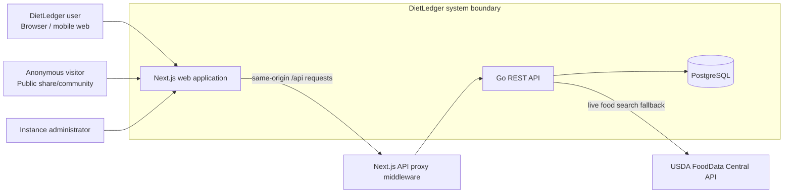
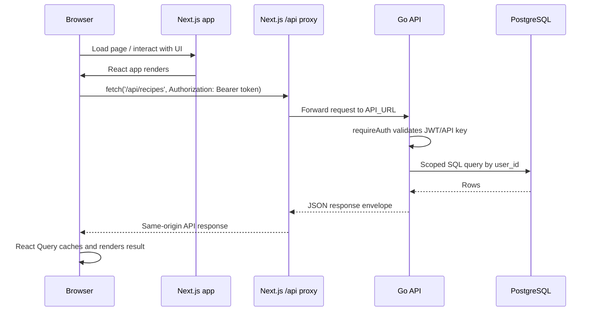
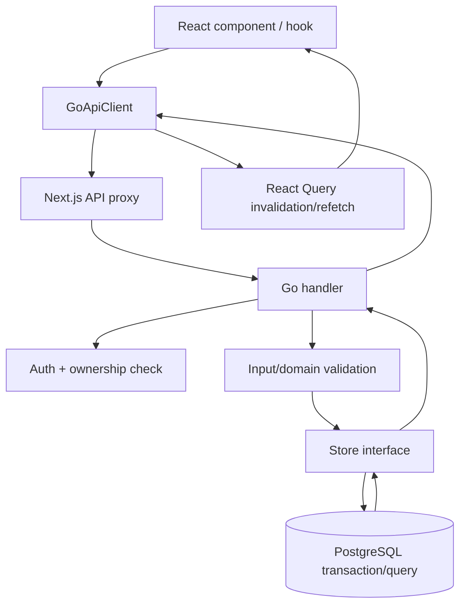
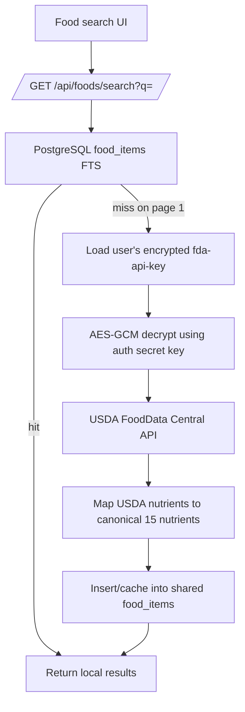
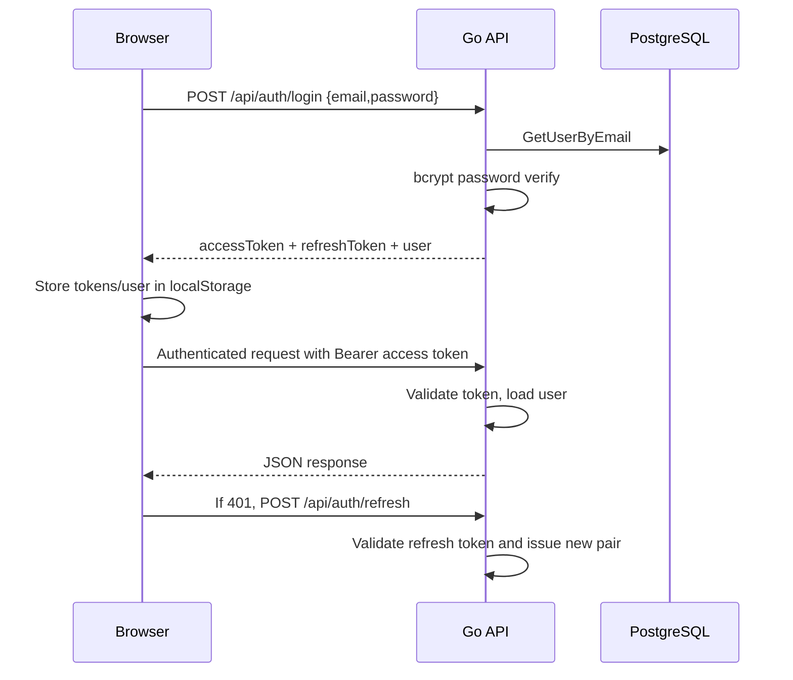
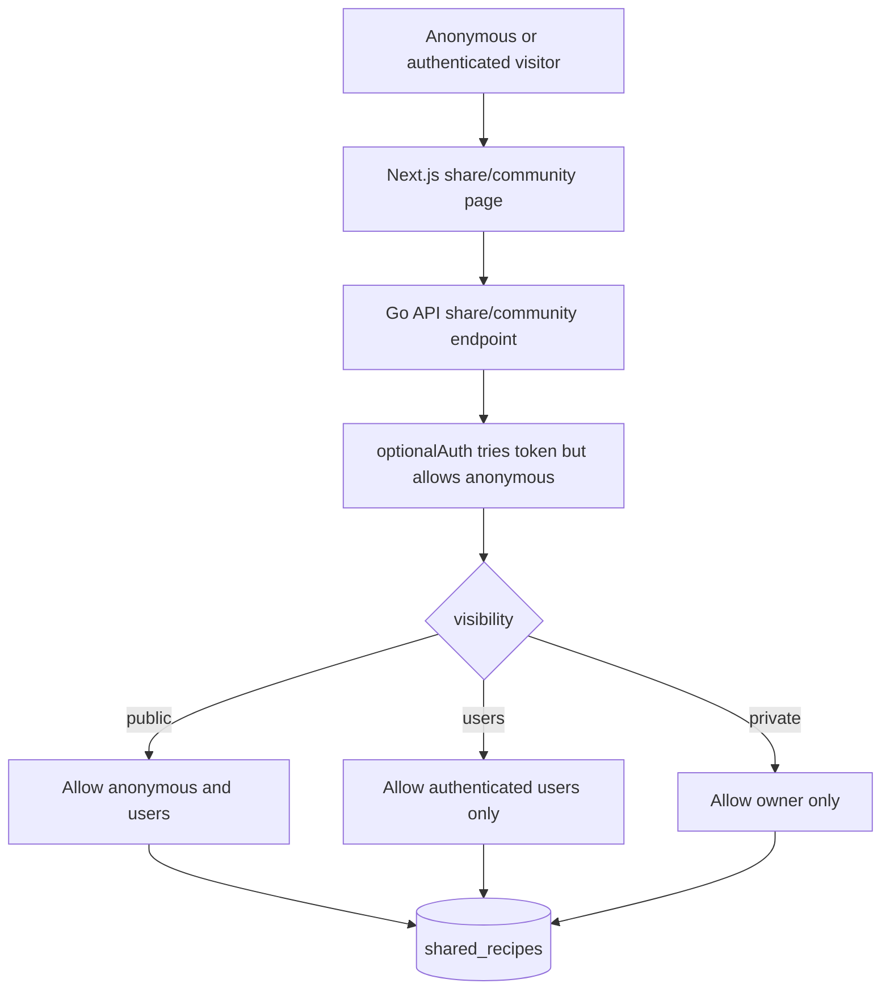
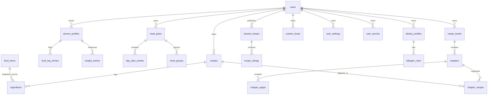

# DietLedger Architecture Review

Status: Source-driven architecture review  
Review method: CodeGraph-first source review plus documentation review  
Primary source files reviewed: `ARCHITECTURE.md`, `PROJECT.md`, `NUTRITION_DOMAIN.md`, `DECISIONS.md`, `DATA_STORE.MD`, `docs/userdocs/01-system-architecture.md`, `sync-server/server.go`, `sync-server/main.go`, `sync-server/repository.go`, `sync-server/store_postgres.go`, `sync-server/auth.go`, `sync-server/migrate.go`, `src/lib/api-client.ts`, `src/lib/api-client-go.ts`, `src/proxy.ts`, `middleware.ts`, `docker-compose.yml`, `docker-compose.build.yml`.

> Important documentation finding: the current source code matches the newer server-authoritative architecture in `ARCHITECTURE.md` and `DECISIONS.md`. `DATA_STORE.MD` still documents older local/offline/IndexedDB/SQLite architecture that has been removed or demoted from the authoritative runtime path. Treat `DATA_STORE.MD` as historical until it is rewritten.

---

## 1. System purpose and requirements

DietLedger is a hosted, account-based nutrition platform. It combines recipe management, food data, meal planning, grocery planning, food logging, health tracking, dietary compliance, cookbook publishing, and recipe sharing into one integrated nutrition workflow.

### Product mission

Help people understand, plan, track, and improve nutrition using accurate food data and practical tools.

### Primary users

| User type | Needs |
|---|---|
| Home cooks | Recipe management, nutrition labels, meal planning, grocery generation |
| Health-conscious individuals | Food logging, nutrient tracking, weight and health trends |
| Families | Multi-person planning and tracking |
| Nutrition professionals | Client-style tracking, dietary compliance, reporting, meal planning |

### Core workflow

```text
Food data -> Ingredients -> Recipes -> Meal plans -> Grocery lists -> Consumption -> Food logs -> Nutrition analysis -> Health tracking
```

### Functional capabilities

- Account registration, login, refresh, registration control, onboarding state.
- Recipe CRUD, ingredients, categories, recipe completions.
- Food search backed by local PostgreSQL data with USDA FoodData Central live fallback when the user supplies an encrypted API key.
- Custom foods and shared custom-food community listing.
- Nutrition profiles, food logs, weight entries, nutrient goals, and health metrics.
- Meal plans, day entries, meal groups, grocery checklists.
- Cookbook structures: books, chapters, chapter pages, book pages, chapter recipes, ordering, and moves.
- Recipe sharing and community recipe gallery with three visibility tiers: `private`, `users`, `public`.
- User settings, templates, dietary profiles, allergen rules, brand kits, pantry staples, user location, seasonal foods, and encrypted user secrets.
- Instance/admin workflows: onboarding completion, registration toggle, user list, reset user data, factory reset.

### Nonfunctional requirements that are explicit in project documentation

- Nutrition accuracy is a first-class product requirement.
- PostgreSQL is the authoritative datastore.
- Go API owns business rules, validation, authorization, and persistence orchestration.
- Frontend is presentation and interaction only.
- React Query owns server-state caching on the client.
- Zustand may own transient UI state only.
- Architecture must remain understandable and maintainable by one developer using AI-assisted development.
- Prefer simple, direct, REST-based systems over speculative abstractions.
- Changes must be spec-driven, test-driven when behavior changes, documented, and verified.

---

## 2. Architecture drivers and constraints

| Driver / constraint | Architectural effect |
|---|---|
| Nutrition correctness | Canonical 15-nutrient model; protected calculation areas; tests expected for serving, units, BMI/BMR/TDEE, goal and dietary logic. |
| Single source of truth | PostgreSQL stores authoritative domain data. Browser storage is not authoritative. |
| Server authority | Go API enforces validation, authorization, ownership, and persistence. |
| Solo-developer maintainability | Single API, single primary database, REST, explicit handlers, no microservices. |
| AI-assisted development | CodeGraph-first discovery, source-driven changes, simple ownership boundaries, documentation as implementation artifact. |
| Hosted account-based deployment | Browser + Next.js container + Go API container + PostgreSQL container. |
| Low operational burden | Docker Compose deployment; no distributed cache, broker, event sourcing, sharding, or Kubernetes requirement. |
| USDA food-data integration | Shared `food_items` cache; per-user encrypted USDA/FDA key; live fallback only after local miss. |
| Multi-user ownership | Most private tables include `user_id`; authenticated handlers scope data to current user. |
| Public sharing | Optional-auth routes allow public visitors while allowing authenticated users to see `users` visibility content. |
| Performance simplicity | PostgreSQL indexes, FTS/Gin search for foods, pagination limits, React Query caching, bounded body sizes. |
| Deployment environment | Remote host `deploy.example.invalid`; deployable artifact is a single combined Docker image tar plus `docker-compose.yml`. |

---

## 3. System context and boundaries

### Context diagram



### Trust and ownership boundaries

| Boundary | Inside | Outside / not trusted |
|---|---|---|
| Browser boundary | UI rendering, forms, local token storage, React Query cache | Authoritative business logic, ownership decisions, persistence authority |
| Next.js boundary | Presentation, routing, same-origin `/api` proxy | Domain API implementation |
| Go API boundary | Validation, auth, authorization, business rules, persistence orchestration | Raw browser claims; client-calculated domain authority |
| Database boundary | Durable state, relational integrity, indexes, migrations | Application workflows that belong in Go code |
| Public internet boundary | Public share/community reads where allowed | Private resources, secrets, admin actions |
| External provider boundary | USDA live food search | DietLedger availability and correctness cannot depend entirely on USDA availability |

### What is inside DietLedger

- Next.js frontend and API proxy middleware.
- Go API server.
- PostgreSQL database and migrations.
- Docker build/deployment scripts.
- Public static assets and service worker.

### What is outside DietLedger

- End-user browsers and devices.
- USDA FoodData Central API.
- Docker host and underlying network/storage.
- LinkedIn or other publishing channels.

---

## 4. Major components and responsibilities

### Container-level components

| Component | Technology | Owns | Must not own |
|---|---|---|---|
| Browser | Web browser | User interaction, rendered UI, local token persistence, React Query cache | Authoritative data, secrets as durable storage, authorization decisions |
| Next.js web app | Next.js, React, TypeScript | Routing, rendering, forms, UI state, server-state hooks, same-origin API proxy | Business rules, persistence, authorization |
| Go API | Go `net/http` server | REST contracts, validation, business rules, auth, authorization, migrations, repository orchestration, USDA fallback | Presentation, client UI workflows |
| PostgreSQL | PostgreSQL 17 | Persistent data, constraints, indexes, full-text search, migration history | Cross-resource application workflows |
| USDA API | External HTTP API | External food data search | DietLedger identity, user data, application state |

### Code-level backend components

| Area | Source | Responsibility |
|---|---|---|
| HTTP server and routes | `sync-server/server.go` | Route registration, middleware, CORS, response helpers, auth wrappers. |
| Startup/runtime | `sync-server/main.go` | Env loading, PostgreSQL connection, migrations, category seed, auth service, rate limiter, HTTP timeouts, graceful shutdown. |
| Auth service | `sync-server/auth.go` | Registration/login/refresh token generation and validation; password checks; HMAC or RSA signing. |
| Store contract | `sync-server/repository.go` | Persistence interface and domain repository boundary. |
| PostgreSQL implementation | `sync-server/store_postgres.go` | SQL persistence, scoped reads/writes, food FTS queries, connection pool. |
| Migrations | `sync-server/migrations/*.sql`, `sync-server/migrate.go` | Schema evolution and migration history. |
| CRUD/domain handlers | `sync-server/handlers_*.go` | REST behavior for each resource group. |
| Nutrition validation | `sync-server/validation*.go` | Input validation for nutrients, servings, profiles, logs, weight, enums, pagination. |
| USDA import/fallback | `sync-server/seed.go`, `sync-server/usda_live.go`, `sync-server/handlers_food.go` | Bulk dataset import, live USDA search fallback, nutrient mapping. |

### Code-level frontend components

| Area | Source | Responsibility |
|---|---|---|
| API client contract | `src/lib/api-client.ts` | Typed client interface for frontend code. |
| Go API client | `src/lib/api-client-go.ts` | Fetch requests, bearer token attachment, refresh retry, 429 retry, response unwrap. |
| API proxy | `src/proxy.ts`, `middleware.ts` | Proxy browser `/api/*` calls from Next.js to Go API via `API_URL`. |
| Auth provider | `src/hooks/use-auth.tsx` | Login/register/logout UI state; token and user persistence in localStorage; query clearing. |
| React Query provider | `src/components/query-provider.tsx`, `src/lib/query-client.ts` | Client-side server-state cache, stale time, retry, garbage collection. |
| Feature hooks | `src/hooks/use-*.ts` | UI-facing data access and mutations for recipes, books, nutrition, meal plans, settings, etc. |
| App routes | `src/app/(app)`, `src/app/(auth)`, `src/app/setup`, `src/app/welcome` | Authenticated app, public/auth/setup/welcome pages. |

---

## 5. Component interactions and data flow

### Runtime request flow



### Write flow



### Food search critical path



### Authentication/session flow



### Public sharing flow



---

## 6. Interfaces and contracts

### API style

- REST over HTTP.
- JSON request/response bodies.
- Success envelope commonly uses `{ "ok": true, "data": ... }` for resource handlers.
- Errors use `{ "ok": false, "error": "message" }`.
- Authenticated endpoints expect `Authorization: Bearer <access-token-or-api-key>`.
- API keys are accepted through the same `Bearer` header path after JWT validation fails.
- Public/optional endpoints exist for health/about, instance state, public share/community visibility, community categories, seasonal foods, and auth endpoints.

### Major route groups

| Group | Representative endpoints | Auth expectation |
|---|---|---|
| System | `GET /api/health`, `GET /api/about` | Public |
| Auth | `POST /api/auth/register`, `/login`, `/refresh` | Public |
| Instance/admin | `/api/instance/state`, `/registration`, `/reset-user-data`, `/factory-reset`, `/users` | State public; mutations/list admin |
| Account | `/api/account/delete-data`, `/api/account/delete` | Auth + password-gated handler |
| Recipes | `/api/recipes`, `/api/recipes/{id}`, `/api/recipes/completions` | Auth |
| Foods | `/api/foods/search`, `/api/foods/{fdcId}`, `/api/foods/upc/{upc}` | Auth in current Go routes |
| Nutrition | `/api/profiles`, profile log/weight routes | Auth |
| Meal planning | `/api/meal-plans`, entries, groups, grocery | Auth |
| Books/publishing | `/api/books`, `/api/chapters`, `/api/pages`, templates, brand kits | Auth |
| Dietary | `/api/dietary-profiles`, `/api/allergen-rules` | Auth |
| Sharing/community | `/api/share`, `/api/share/{token}`, `/api/community` | Writes auth; reads public/optional depending on visibility |
| Settings/secrets | `/api/settings`, `/api/settings/location`, `/api/secrets` | Auth, except seasonal foods read path |

### Contract observations

- `docs/userdocs/02-api-reference.md` still lists a logout lifecycle, but the reviewed Go routes do not include `POST /api/auth/logout`; logout is currently client-side token deletion.
- Some docs still describe Next.js API routes/local storage flows that are not the authoritative path. Current frontend `getApiClient()` always returns `GoApiClient('')`, and `/api` proxy middleware forwards domain routes to the Go API.
- API versioning is not explicit. The compatibility rule is currently “keep explicit boring contracts and update typed client + handlers together.”

---

## 7. Data architecture

### Authoritative storage

PostgreSQL is the system of record. The Go API requires `DATABASE_URL` and exits if it is not set. Runtime startup runs embedded PostgreSQL migrations before serving traffic.

### Persistence diagram



### Major data groups

| Group | Tables / source | Ownership |
|---|---|---|
| Identity/session | `users`, `api_keys`, historical `refresh_tokens` table | Per user; first user becomes admin via migration; API keys scoped to user. |
| Instance metadata | `instance_meta` | Single row; onboarding and registration toggle. |
| Recipes | `recipes`, `ingredients`, `recipe_categories`, `recipe_completions` | Per user for recipes/completions; categories are shared taxonomy. |
| Food data | `food_items`, `seed_jobs` | Shared cache of USDA/imported data; admin/import and live fallback populate it. |
| Nutrition | `person_profiles`, `food_log_entries`, `weight_entries` | Per user/profile; food logs are nutrient snapshots. |
| Meal planning | `meal_plans`, `day_plan_entries`, `meal_groups`, `grocery_checklists` | Per user, week/date structured. |
| Cookbook publishing | `recipe_books`, `chapters`, `chapter_recipes`, `chapter_pages`, `book_pages`, `templates`, `brand_kits` | Mostly per user; templates may include defaults. |
| Dietary/settings | `dietary_profiles`, `allergen_rules`, `user_settings`, `user_locations`, `pantry_staples` | Per user. |
| Sharing/community | `shared_recipes`, `recipe_ratings`, `community_categories` | Shared/public surface with visibility enforcement. |
| Secrets | `user_secrets` | Per-user encrypted values, currently used for USDA/FDA API keys. |
| Reference seasonal data | `seasonal_foods` | Shared by country/region/month. |

### Data lifecycle

- Schema lifecycle: embedded SQL migrations in `sync-server/migrations`, recorded in `schema_migrations`.
- User-owned lifecycle: most private rows cascade on `users` delete via foreign keys or handler-managed delete.
- Food log lifecycle: historical nutrient snapshots are intentionally stable and do not automatically change when recipes or foods change.
- Food cache lifecycle: shared `food_items` grows from bulk seed jobs or live USDA fallback. Cache clearing/import is admin concern per ADR.
- Client cache lifecycle: React Query caches server state; cache is invalidated/refetched after mutations and cleared on auth changes.

### Indexing and consistency

- PostgreSQL constraints and foreign keys enforce durable integrity.
- `food_items` uses PostgreSQL full-text search (`search_vector`, GIN index, trigger) for food search.
- Pagination is bounded server-side with `perPage` capped at 100.
- The canonical 15-nutrient model appears in food items, ingredients, recipes/log/plan snapshots, and nutrition calculations.

---

## 8. Security architecture

### Authentication and authorization

- Passwords are hashed with bcrypt.
- Access and refresh tokens are signed JWTs. `HMAC_SECRET` enables HS256; optional RSA key path enables RS256 signing.
- `requireAuth` accepts valid JWT access tokens or API keys supplied as bearer tokens.
- `optionalAuth` attaches user context when possible but allows anonymous access for share/community scenarios.
- `requireAdmin` gates instance-level administrative actions.
- Private resources are intended to be scoped by `user_id` through handler/store methods.

### Secret handling

- Per-user secrets are stored in `user_secrets.encrypted_value`.
- Encryption uses AES-GCM with a 32-byte key derived from `AuthService.SecretKey()`.
- Operational implication: if `HMAC_SECRET` is empty, the server generates a random key at startup. Tokens will not survive restarts, and encrypted user secrets may become undecryptable after restart. Production must set a stable secret.

### Trust boundaries and attack surface

| Surface | Protection currently present |
|---|---|
| Browser -> API | Bearer tokens/API keys, JSON validation, CORS, rate limiter, body limit. |
| Login/register | Password validation and bcrypt; rate limiter applies globally/by remote address. |
| Admin actions | Auth + `is_admin` check; destructive account/admin actions are password-gated in handlers where documented. |
| Food search external call | Requires authenticated user and encrypted per-user USDA key; network timeout is 15 seconds. |
| Public sharing | Visibility tiers enforced server-side. |
| Secrets | Encrypted at rest in database. |

### Security review notes

- Tokens are stored in browser `localStorage`, which is simple but exposes tokens to XSS. This is acceptable only if the app maintains strong XSS hygiene; an HttpOnly-cookie design would reduce token theft risk but add complexity.
- Refresh-token revocation is not apparent in the current `AuthService.RefreshToken` path; it validates the refresh JWT and issues a new pair. If logout/revocation is required, that should become an explicit contract and persistence flow.
- Rate limiting is in-memory and uses request address before route-level auth context is established. Behind the Next.js proxy/container network, this may collapse many users into one address and does not provide distributed protection across API replicas.
- CORS allows configured origins; Docker Compose defaults to localhost and the web container. Avoid `CORS_ORIGIN=*` in exposed production deployments that need credentials.

---

## 9. Performance and scalability

### Current performance mechanisms

| Area | Mechanism |
|---|---|
| Database | PostgreSQL connection pool: max open 25, idle 5, lifetime 5 minutes. |
| Search | PostgreSQL full-text search on `food_items.search_vector` with GIN index. |
| API limits | Body size limit from `MAX_BODY_MB`; server read timeout 30s, write timeout 120s, max header 1 MiB. |
| Pagination | Server-side page/per-page validation; max `perPage` 100. |
| Client cache | React Query default stale time 60s, GC 5m, retry 1, no refetch on focus. |
| Rate limiting | Global limiter 100 rps burst 200; visitor limiter defaults 30 rps burst 60, auth endpoints 10 rps burst 20. |
| Food import | Background seed processor imports USDA data in batches of 500. |

### Expected scale posture

DietLedger is intentionally optimized for a small hosted deployment and solo maintenance:

- One Next.js container.
- One Go API container.
- One PostgreSQL instance.
- Vertical scaling and indexing before distributed architecture.
- Stateless request handling, except for in-memory rate limiter and background seed processor.

### Scalability constraints

- In-memory rate limiting is per API process and not shared.
- Background seed processor starts in every API process; multiple API replicas would need a database lock or single-worker design to avoid duplicated seed work.
- No distributed cache, queue, read replica, or object storage is currently part of the architecture.
- Next.js config constrains experimental CPU usage to 1, favoring deterministic resource usage over build/runtime parallelism.
- Large USDA imports and food search are likely the main database/load hotspots.

### Practical scaling strategy

1. Keep the single-instance architecture until real usage data requires change.
2. Add indexes and query improvements before new infrastructure.
3. Move USDA seed processing behind an explicit worker/lock only if multiple API replicas become necessary.
4. Add reverse proxy/TLS/rate-limit hardening at the edge if public exposure increases.
5. Add database backups and restore drills before optimizing for traffic growth.

---

## 10. Deployment architecture

### Runtime deployment topology

```mermaid
flowchart TD
    Internet[Users on LAN / internet] --> WebPort[Host port ${PORT:-3000}]
    WebPort --> Web[Container: dietledger-web\nImage: recipetool-dietledger\nNext.js standalone server]
    Web -->|API_URL=http://dietledger-api:8080| API[Container: dietledger-api\nImage: recipetool-api\nGo HTTP server]
    API -->|DATABASE_URL| PG[Container: dietledger-postgres\nPostgreSQL 17 Alpine]
    PG --> Vol[(Docker volume: pg-data)]

    Host[Remote Docker host\ndeploy.example.invalid] -. runs .- Web
    Host -. runs .- API
    Host -. runs .- PG
```

### Docker Compose services

| Service | Image | Port | Healthcheck | Key env |
|---|---|---|---|---|
| `postgres` | `postgres:17-alpine` | internal 5432 | `pg_isready` | `POSTGRES_DB`, `POSTGRES_USER`, `POSTGRES_PASSWORD` |
| `api` | `recipetool-api` | `${API_PORT:-8080}:8080` | `GET /api/health` | `PORT`, `DATABASE_URL`, `CORS_ORIGIN`, `HMAC_SECRET`, `JWT_SIGNING_KEY_PATH`, `MAX_BODY_MB` |
| `web` | `recipetool-dietledger` | `${PORT:-3000}:3000` | `GET /` | `NODE_ENV`, `PORT`, `DOCKER`, `API_URL` |

### Build/deploy path

- Build images through `docker buildx bake --load -f docker-compose.build.yml`.
- Save a single combined tar named `docker-build/dietledger-{VERSION}.tar` containing `recipetool-dietledger` and `recipetool-api`.
- Copy `docker-compose.yml` into `docker-build/`.
- Use operator-managed tooling to transfer and load images on the target host.

### Environment differences

| Environment | Notes |
|---|---|
| Local development | `npm run dev` for Next.js; Go API can run locally if `DATABASE_URL` points to PostgreSQL. |
| Docker production | Next.js standalone server and Go API run in separate containers; API connects to Compose PostgreSQL. |
| Remote host | Documented target is `deploy.example.invalid`; local builds do not update running services until Docker image tar is deployed. |

---

## 11. Documentation alignment findings

| Document | Current status from review |
|---|---|
| `ARCHITECTURE.md` | Matches current server-authoritative intent. Good high-level source of truth. |
| `PROJECT.md` | Good product purpose and requirements source. |
| `NUTRITION_DOMAIN.md` | Good domain source; aligns with canonical nutrient model and snapshot semantics. |
| `DECISIONS.md` | Matches current direction and includes key ADRs; some ADRs supersede older storage docs. |
| `docs/userdocs/01-system-architecture.md` | Broadly aligned but high level; can be expanded or linked to this review. |
| `docs/userdocs/02-api-reference.md` | Useful skeleton but incomplete/stale in places, especially logout and newly implemented route groups. |
| `DATA_STORE.MD` | Stale/historical for current runtime; describes removed local/offline/IndexedDB/SQLite authoritative modes. Should be rewritten or archived. |

---

## 12. Architecture review summary

DietLedger is best explained as a deliberately simple, server-authoritative nutrition platform:

```text
Browser UI -> Next.js presentation/proxy -> Go REST API -> PostgreSQL source of truth
```

The architecture is shaped less by massive scale and more by correctness, maintainability, nutrition accuracy, and solo-developer velocity. The strongest architectural idea is clear ownership: PostgreSQL owns durable state, the Go API owns business rules and authorization, React Query owns client server-state cache, and the browser never owns authoritative domain data.

The main improvement opportunity is documentation cleanup: archive or rewrite older local/offline storage documentation so future humans and AI agents do not reintroduce removed complexity.
